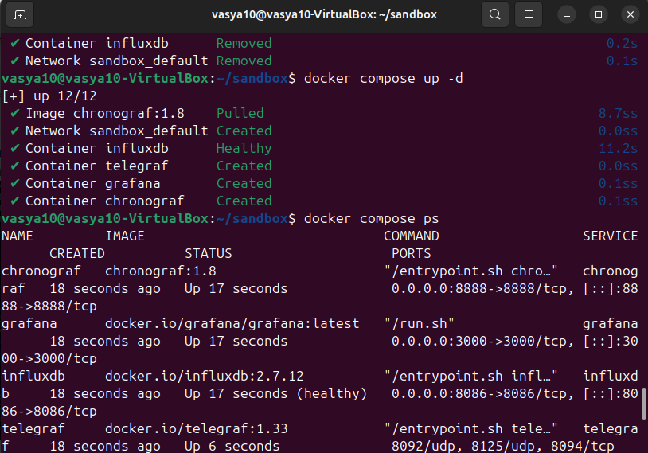
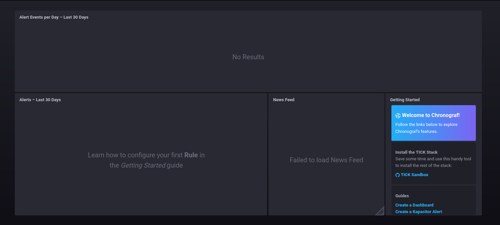
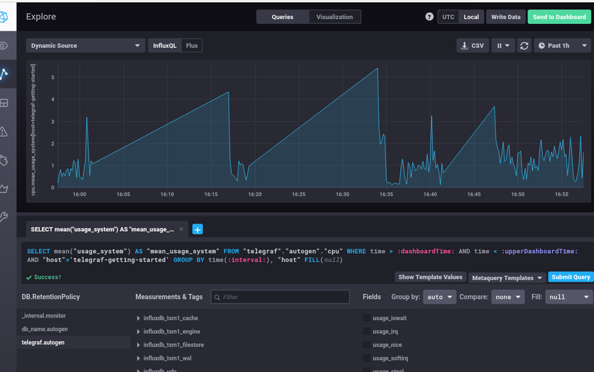
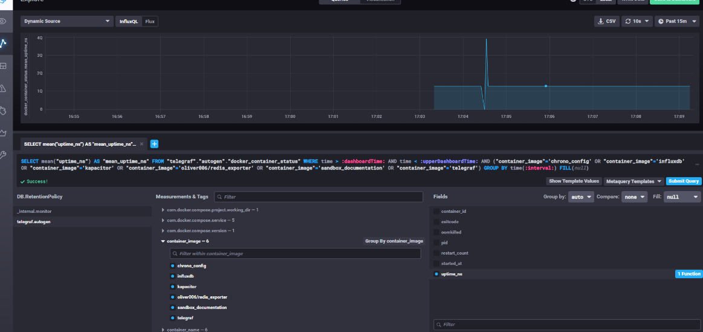

# Домашнее задание к занятию "13.Системы мониторинга" Василий Ткаченко

## Обязательные задания

1. Вас пригласили настроить мониторинг на проект. На онбординге вам рассказали, что проект представляет из себя 
платформу для вычислений с выдачей текстовых отчетов, которые сохраняются на диск. Взаимодействие с платформой 
осуществляется по протоколу http. Также вам отметили, что вычисления загружают ЦПУ. Какой минимальный набор метрик вы
выведите в мониторинг и почему?

Минимальный набор метрик:

    CPU utilization -потому что вычисления сильно нагружают процессор.
    Memory usage - чтобы не допустить OOM‑убийства процесса.
    Disk space и latency - отчёты пишутся на диск, важно следить за местом и скоростью записи.
    HTTP latency (p95/p99) и коды ответов (2xx/4xx/5xx) — чтобы видеть, как быстро сервис отвечает и есть ли ошибки.
    RPS (запросов в секунду) - для оценки нагрузки и связи с ростом CPU/диска.

    Менеджер продукта посмотрев на ваши метрики сказал, что ему непонятно что такое RAM/inodes/CPUla. Также он сказал, 
что хочет понимать, насколько мы выполняем свои обязанности перед клиентами и какое качество обслуживания. Что вы 
можете ему предложить?

    Смогу предложить менеджеру такие понятные бизнес‑метрики вместо технических:

    SLA по времени ответа (например, «95 % запросов за ≤ 2 секунды») - сразу видно, держим ли обещанную скорость.
    
    Доля успешных запросов («99,9 % ответов 200 OK») - показывает, насколько сервис надёжен для клиентов.
    
    Время генерации отчёта (среднее и p95) - прямо отражает качество ключевой функции.
    
    Доступность сервиса (% времени, когда API отвечал) - простой показатель «сервис работает/не работает».
    
    Количество ошибок, влияющих на клиента (5xx, таймауты) - понятно, сколько раз пользователь столкнулся с проблемой.

Эти метрики связывают твою техническую работу (CPU, диск, память) с качеством обслуживания: например, рост CPU будет виден как рост времени генерации отчёта, а нехватка места на диске - как рост ошибок.

Вашей DevOps команде в этом году не выделили финансирование на построение системы сбора логов. Разработчики в свою 
очередь хотят видеть все ошибки, которые выдают их приложения. Какое решение вы можете предпринять в этой ситуации, 
чтобы разработчики получали ошибки приложения?

Вот простые бюджетные варианты:

    Логи в stdout/stderr — разработчики смотрят их через консоль или терминал.
    
    Отдельный файл с ошибками (например, errors.log) - дают доступ к файлу и советуют использовать tail -f для отслеживания в реальном времени.
    
    Уведомления о критических ошибках - при серьёзной ошибке приложение шлёт сообщение в чат или на почту.
    
    Включить логирование уровня ERROR в настройках приложения - чтобы ошибки точно фиксировались и не терялись.

    Вы, как опытный SRE, сделали мониторинг, куда вывели отображения выполнения SLA=99% по http кодам ответов. 
Вычисляете этот параметр по следующей формуле: summ_2xx_requests/summ_all_requests. Данный параметр не поднимается выше 
70%, но при этом в вашей системе нет кодов ответа 5xx и 4xx. Где у вас ошибка?

    
Ошибка в формуле: мы учитываем только 2xx, а SLA по доступности обычно считают как долю успешных ответов - то есть 2xx и 3xx (перенаправления тоже считаются успешной обработкой запроса).

Если 3xx‑запросов много, то при текущей формуле SLA будет занижаться - вот почему показатель не поднимается выше 70 %, даже без 4xx и 5xx.

Правильная формула:
(summ_2xx_requests + summ_3xx_requests) / summ_all_requests.

Опишите основные плюсы и минусы pull и push систем мониторинга.

Pull‑системы (например, Prometheus)

Плюсы:

    проще контролировать объём данных - система сама забирает нужное;
    удобно отлаживать: метрики доступны через endpoint, можно открыть в браузере;
    меньше риска «заспамить» хранилище: сбор идёт по расписанию, а не при каждом событии.

Минусы:

    приложения должны держать endpoint и отдавать метрики;
    сложно собрать данные с недоступных или очень динамичных сервисов (быстро появляющихся/исчезающих);
    при большой нагрузке частый опрос может нагружать сервисы.

Push‑системы (например, отправка метрик в InfluxDB, Graphite)

Плюсы:

    приложение само отправляет данные - не нужен внешний опрос;
    хорошо подходит для контейнеров, serverless, мобильных клиентов и других сред, где сервис «не виден» извне;
    легко масштабировать приём данных на стороне хранилища.

Минусы:

    выше риск избыточных данных: сервисы могут слать слишком много метрик;
    сложнее контролировать консистентность и периодичность - каждый отправитель решает сам, как часто слать;
    нужно защищать канал передачи и управлять аутентификацией на стороне клиентов.

    Какие из ниже перечисленных систем относятся к push модели, а какие к pull? А может есть гибридные?

    - Prometheus 
    - TICK
    - Zabbix
    - VictoriaMetrics
    - Nagios

    Pull. Система сама периодически «опрашивает» источники — запрашивает метрики у приложений, серверов или агентов. Prometheus — классический пример: он скрапит (забирает) метрики с эндпоинтов целевых сервисов. Zabbix и Nagios тоже в основном работают по такому принципу: сервер активно проверяет хосты и сервисы, забирает данные через агенты или напрямую. 
    
Push. Здесь инициатор - сам источник (приложение, агент). Он активно отправляет (пушит) собранные метрики в систему мониторинга. В стеке TICK за сбор и отправку как раз отвечает компонент Telegraf: он собирает данные на стороне источника и передаёт их дальше (например, в InfluxDB).

Гибридные. Система умеет и то, и другое. VictoriaMetrics поддерживает обе модели: можно настроить, чтобы она забирала метрики (pull), а можно - чтобы источники сами их отправляли (push). Это удобно, когда в инфраструктуре разные сценарии: часть сервисов доступна для опроса, а часть (например, короткоживущие задачи или системы за фаерволом) лучше пушить.

7. Склонируйте себе репозиторий и запустите TICK-стэк, используя технологии docker и docker-compose.
В виде решения на это упражнение приведите скриншот веб-интерфейса ПО chronograf (http://localhost:8888).

P.S.: если при запуске некоторые контейнеры будут падать с ошибкой - проставьте им режим Z, например ./data:/var/lib:Z

8. Перейдите в веб-интерфейс Chronograf (http://localhost:8888) и откройте вкладку Data explorer.

Нажмите на кнопку Add a query
Изучите вывод интерфейса и выберите БД telegraf.autogen
В measurments выберите cpu->host->telegraf-getting-started, а в fields выберите usage_system. Внизу появится график утилизации cpu.
Вверху вы можете увидеть запрос, аналогичный SQL-синтаксису. Поэкспериментируйте с запросом, попробуйте изменить группировку и интервал наблюдений.
Для выполнения задания приведите скриншот с отображением метрик утилизации cpu из веб-интерфейса.

9. Изучите список telegraf inputs. Добавьте в конфигурацию telegraf следующий плагин - docker:
[[inputs.docker]]
  endpoint = "unix:///var/run/docker.sock"
Дополнительно вам может потребоваться донастройка контейнера telegraf в docker-compose.yml дополнительного volume и режима privileged:

  telegraf:
    image: telegraf:1.4.0
    privileged: true
    volumes:
      - ./etc/telegraf.conf:/etc/telegraf/telegraf.conf:Z
      - /var/run/docker.sock:/var/run/docker.sock:Z
    links:
      - influxdb
    ports:
      - "8092:8092/udp"
      - "8094:8094"
      - "8125:8125/udp"
После настройке перезапустите telegraf, обновите веб интерфейс и приведите скриншотом список measurments в веб-интерфейсе базы telegraf.autogen . Там должны появиться метрики, связанные с docker.

    

